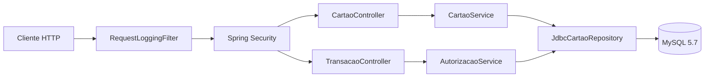

# Mini autorizador

API REST para criação de cartões, consulta de saldo e autorização de compras.
Cada cartão começa com R$ 500,00. Uma compra aprovada debita o saldo; uma
compra recusada não o altera.

Implementado com Java 17, Spring Boot, Spring JDBC, Flyway e MySQL 5.7.

O enunciado original está em [DESAFIO-VR.md](DESAFIO-VR.md).

## Como executar

### Pré-requisitos

- JDK 17
- Docker com suporte a containers Linux e Docker Compose
- Portas 3306 e 8080 disponíveis

Não é necessário instalar o Maven: o projeto inclui o Maven Wrapper.

Os comandos abaixo são para PowerShell, executados na raiz do projeto.

### 1. Iniciar o banco

```powershell
docker compose -f docker\docker-compose.yml up -d mysql
```

Antes de iniciar a aplicação, aguarde o MySQL ficar pronto. Para acompanhar
a inicialização:

```powershell
docker compose -f docker\docker-compose.yml logs mysql
```

Procure a mensagem `ready for connections` do servidor que atende na porta 3306.

### 2. Iniciar a aplicação

```powershell
.\mvnw.cmd spring-boot:run
```

A API fica disponível em `http://localhost:8080`.

O Flyway aplica a migração automaticamente na inicialização. Não é
necessário criar a tabela manualmente.

A configuração local utiliza o banco `miniautorizador` em
`localhost:3306`, com usuário `root` e senha vazia, conforme o Compose
fornecido no desafio. Essa configuração é destinada à execução local.

### Autenticação

Todos os endpoints exigem HTTP Basic:

- Usuário: `username`
- Senha: `password`

Essas credenciais autenticam o acesso à API. A senha do cartão é outra
informação, definida no cadastro e verificada na autorização da compra.

O arquivo [requests.http](requests.http) contém exemplos de chamadas.

## API

URL base: `http://localhost:8080`.

Todas as chamadas exigem HTTP Basic. Os corpos das requisições POST
devem ser enviados com `Content-Type: application/json`.

### Criar cartão

`POST /cartoes`

```json
{
  "numeroCartao": "6549873025634501",
  "senha": "1234"
}
```

| Status | Resposta |
|---|---|
| `201` | JSON com `numeroCartao` e `senha` recebidos |
| `422` | Cartão já cadastrado; JSON com os dados enviados nesta tentativa |

O cadastro duplicado não altera a senha nem o saldo do cartão existente.
A senha devolvida na resposta é a recebida na requisição, conforme o
contrato do desafio, e não uma senha recuperada do banco.

### Consultar saldo

`GET /cartoes/{numeroCartao}`

| Status | Resposta |
|---|---|
| `200` | Saldo como número JSON, sem objeto ou aspas |
| `404` | Cartão não encontrado; resposta sem corpo |

Exemplo do corpo da resposta para um cartão recém-criado:

```json
500.00
```

### Autorizar compra

`POST /transacoes`

```json
{
  "numeroCartao": "6549873025634501",
  "senhaCartao": "1234",
  "valor": 10.00
}
```

| Status | Corpo da resposta (`text/plain`) |
|---|---|
| `201` | `OK` |
| `422` | `CARTAO_INEXISTENTE` |
| `422` | `SENHA_INVALIDA` |
| `422` | `SALDO_INSUFICIENTE` |

Com os dados de entrada válidos, as regras são verificadas nesta ordem:
existência do cartão, senha e saldo disponível.

A compra aprovada debita o saldo. As recusas não alteram o saldo.

### Autenticação e erros de entrada ou persistência

Credenciais ausentes ou incorretas resultam em `401`.

Entradas inválidas e falhas tratadas de persistência utilizam um corpo
JSON com os campos `codigo` e `mensagem`:

| Status | Código | Mensagem |
|---|---|---|
| `400` | `REQUISICAO_INVALIDA` | `Verifique os campos enviados.` |
| `503` | `ERRO_PERSISTENCIA` | `Não foi possível concluir a operação.` |

Exemplo de resposta `400`:

```json
{
  "codigo": "REQUISICAO_INVALIDA",
  "mensagem": "Verifique os campos enviados."
}
```

Uma falha de persistência não é convertida em recusa por saldo
insuficiente nem em aprovação.

## Testes

Os comandos abaixo são para PowerShell, executados na raiz do projeto.

### Testes unitários e de controller

```powershell
.\mvnw.cmd test
```

Executa os testes das regras de negócio e dos contratos HTTP, incluindo
autenticação e validação de entrada. Não exige Docker nem MySQL ativo.

### Suíte completa

Com o Docker em execução:

```powershell
.\mvnw.cmd clean verify
```

Além dos testes anteriores, executa a integração com MySQL 5.7.44 via
Testcontainers e gera o relatório de cobertura.

Por padrão, os testes criam um banco descartável e separado do banco
utilizado na execução manual. Não é necessário iniciar o Compose.

Os testes de integração verificam:

- Aplicação das migrações e persistência dos cartões.
- Cadastro, duplicidade, consulta e autorização de compras.
- Preservação do saldo nas recusas.
- Rollback quando ocorre uma falha após o UPDATE real.
- Compras e cadastros concorrentes.
- Disputa pelo mesmo saldo entre dois processos Java.
- Persistência dos dados após reiniciar a aplicação.

A suíte permanece sequencial. Os cenários de concorrência coordenam
explicitamente suas próprias chamadas simultâneas.

### Relatórios

Após `clean verify`:

| Caminho | Conteúdo |
|---|---|
| `target\surefire-reports` | Resultados dos testes unitários e de controller |
| `target\failsafe-reports` | Resultados dos testes de integração |
| `target\site\jacoco\index.html` | Cobertura consolidada |
| `target\instance-*.log` | Logs dos processos usados no teste com duas instâncias |

### Integração contínua

O [workflow de CI](.github/workflows/ci.yml) executa `clean verify`
em pushes e pull requests, com Java 17 e Docker.

Os relatórios e logs são publicados no artefato `relatorios-de-testes`,
disponível por sete dias na respectiva execução do
[GitHub Actions](https://github.com/AdrielDev/mini-autorizador/actions).

## Arquitetura

A aplicação está organizada por funcionalidade, com controllers para
o contrato HTTP, serviços para as regras de negócio e um repositório
JDBC para persistência.



Os serviços dependem da interface `CartaoRepository`, implementada por
`JdbcCartaoRepository`. O tratamento HTTP das exceções conhecidas fica
em `ApiExceptionHandler`.

| Pacote | Responsabilidade |
|---|---|
| `config` | Autenticação e configuração do encoder |
| `cartao` | Cadastro, consulta e persistência dos cartões |
| `transacao` | Validação e autorização das compras |
| `shared` | Respostas e tratamento de erros compartilhados |

### Banco de dados

O schema é criado pelo Flyway e contém uma tabela de negócio,
`cartoes`, utilizando InnoDB:

| Coluna | Tipo | Restrições |
|---|---|---|
| `numero_cartao` | `VARCHAR(16)` | Chave primária, não nulo |
| `senha_hash` | `VARCHAR(255)` | Não nulo |
| `saldo` | `DECIMAL(19, 2)` | Não nulo, sem valor padrão |

Não há tabela de transações: o enunciado exige persistir o cartão e
atualizar seu saldo, mas dispensa o registro das compras.

## Decisões de implementação

As escolhas abaixo atendem ao escopo do desafio. As medidas citadas
para produção e crescimento são possibilidades de evolução, não
funcionalidades já implementadas.

<details>
<summary><strong>Concorrência: débito atômico no banco</strong></summary>

**O problema:** com R$ 10,00 de saldo e duas compras simultâneas de
R$ 10,00, apenas uma pode ser aprovada.

**A escolha:** verificar o saldo e debitar no mesmo UPDATE, sem
calcular um novo saldo em Java:

```sql
UPDATE cartoes
SET saldo = saldo - :valor
WHERE numero_cartao = :numero
  AND saldo >= :valor;
```

Após validar existência e senha, uma linha alterada significa
aprovação; nenhuma significa saldo insuficiente.

**Outras estratégias consideradas:**

| Estratégia | Como funcionaria | Por que não foi necessária |
|---|---|---|
| Pessimista | `SELECT ... FOR UPDATE` bloqueia a linha antes de validar o saldo e realizar o débito | Anteciparia o bloqueio; a regra atual cabe no próprio UPDATE |
| Otimista por versão | Atualiza somente se a versão lida não tiver mudado | Exigiria versionamento e tratamento de conflitos, que não significam necessariamente saldo insuficiente |

O débito atômico foi escolhido por resolver essa regra diretamente
no banco, inclusive entre instâncias diferentes, sem controle de
versão ou retentativas por conflito de versão.

O UPDATE também utiliza locks de linha do InnoDB: não é uma operação
sem bloqueios. A autorização usa `@Transactional` para permitir
rollback em caso de falha antes do commit.

**Evolução possível — idempotência:** caso a integração precise tratar
retentativas, avaliaria uma chave de operação enviada pelo cliente
e reutilizada nos reenvios. A mesma operação não produziria outro débito.

Essa garantia precisaria funcionar entre instâncias, com a chave,
o resultado e o débito coordenados na mesma transação. A validade da
chave e a rejeição de seu reuso com dados diferentes fariam parte
do contrato.

Compras distintas continuariam permitidas, mesmo com o mesmo cartão,
valor e horários próximos.

</details>

<details>
<summary><strong>Senhas: PBKDF2 com salt, sem armazenamento em texto puro</strong></summary>

A aplicação utiliza o `PasswordEncoder` do Spring Security para gerar
e verificar hashes PBKDF2. O salt é gerenciado pela biblioteca, sem
implementação própria de criptografia.

Para produção, a escolha envolveria algoritmo, parâmetros de custo,
tempo de verificação e estratégia de migração dos hashes existentes.
Para um novo serviço, avaliaria Argon2id conforme as
[recomendações da OWASP](https://cheatsheetseries.owasp.org/cheatsheets/Password_Storage_Cheat_Sheet.html).

Manter PBKDF2 também exigiria revisar seus parâmetros conforme as
recomendações atuais e medir o custo sob carga. Cada compra envolve
a validação da credencial da API e da senha do cartão.

</details>

<details>
<summary><strong>Autenticação: HTTP Basic conforme o contrato</strong></summary>

HTTP Basic foi mantido porque é exigido pelo desafio. A aplicação
não cria uma sessão de login; cada chamada apresenta suas credenciais.

Fora do ambiente local, HTTPS seria obrigatório, além de gestão e rotação de credenciais, limitação de tentativas e proteção contra exposição de senhas
e cabeçalhos de autenticação em logs.

Para uma integração entre sistemas, avaliaria OAuth2 Client Credentials
com tokens de curta duração e escopos de acesso. Isso permite evitar
o envio da credencial de longa duração em cada chamada de negócio.

Tokens podem ser opacos ou JWT, conforme os requisitos de validação
e revogação. JWT não torna uma API segura por si só: validade,
emissor, destinatário e assinatura precisam ser verificados,
e HTTPS continua necessário.

A adoção de outro mecanismo não faz parte desta entrega e não
substituiria o contrato exigido sem uma mudança acordada.

</details>

<details>
<summary><strong>Estrutura e legibilidade: camadas organizadas por funcionalidade</strong></summary>

Os pacotes `cartao` e `transacao` agrupam funcionalidades. Dentro deles,
controllers tratam HTTP, serviços coordenam as regras e o repositório
concentra o acesso ao banco.

Os princípios aparecem em decisões concretas:

- **Responsabilidade única:** contrato HTTP, autorização e SQL
  ficam em componentes com papéis distintos.
- **Inversão de dependência:** os serviços dependem de
  [CartaoRepository](src/main/java/br/com/miniautorizador/cartao/repository/CartaoRepository.java),
  não diretamente da implementação JDBC.
- **Dependências explícitas:** injeção por construtor facilita
  identificar colaboradores e testar os serviços isoladamente.
- **Tratamento específico de falhas:** duplicidade é distinguida
  de falha técnica, sem transformar qualquer erro em recusa de negócio.

JDBC mantém o SQL explícito para um modelo com uma tabela e poucas
operações. A chave primária garante unicidade também em cadastros
concorrentes; uma consulta prévia, sozinha, não garantiria isso.

Valores monetários utilizam `BigDecimal` e `DECIMAL(19, 2)`,
sem arredondamento silencioso. O saldo inicial permanece no código
como regra de cadastro, sem DEFAULT no banco.

A estrutura busca coesão e leitura direta, sem introduzir interfaces,
camadas ou padrões onde não há uma necessidade concreta.

</details>

<details>
<summary><strong>Evolução: medir antes de distribuir</strong></summary>

O primeiro passo seria medir latência, vazão, custo das verificações
de senha, uso do pool de conexões e espera por locks.

A aplicação pode executar em mais de uma instância mantendo a
proteção do débito no banco. Entretanto, adicionar instâncias não
elimina a contenção de muitas compras sobre o mesmo cartão.

As próximas evoluções dependeriam desses resultados e de requisitos:

- Idempotência para impedir que retentativas da mesma compra
  produzam novos débitos.
- Métricas, rastreamento e alertas sem exposição de credenciais.
- Histórico e auditoria, caso passem a fazer parte do negócio.
- Fronteiras de módulos mais explícitas, caso o domínio cresça.

Cache não seria a fonte de verdade para autorizar saldo.
Microserviços ou mensageria só entrariam diante de uma necessidade
demonstrada de isolamento, processamento ou implantação independente.

Os testes concorrentes comprovam os cenários exercitados;
não substituem testes de carga nem estabelecem capacidade de produção.

</details>

## Observabilidade

Cada requisição recebe um UUID gerado pelo servidor, devolvido no header
`X-Request-ID` e associado aos logs durante seu processamento síncrono.
Identificadores enviados pelo cliente não são reutilizados.

Os logs registram método, rota parametrizada, status, duração e resultado
da autorização, sem registrar corpos, credenciais ou dados do cartão.

Os endpoints operacionais exigem o mesmo HTTP Basic da API:

| Endpoint | Finalidade |
|---|---|
| `/actuator/health` | Saúde da aplicação e do banco, sem detalhes dos componentes |
| `/actuator/metrics/jvm.memory.used` | Uso de memória da JVM |
| `/actuator/metrics/http.server.requests` | Métricas das requisições HTTP |

Essa identificação permite correlacionar os logs de uma requisição.
Não representa tracing distribuído nem histórico financeiro.

## Suposições e limites

- O número do cartão é um identificador textual com exatamente
  16 caracteres, sem espaços. Zeros à esquerda são preservados.
  Não há validação de bandeira ou algoritmo de Luhn.
- Não foi imposta uma restrição para aceitar somente dígitos.
  A comparação no banco segue a collation padrão de `utf8mb4`
  do MySQL 5.7, sem distinção entre maiúsculas e minúsculas.
- A senha não pode estar em branco e possui limite de 128 caracteres.
- O valor da compra deve ser positivo, caber em `DECIMAL(19, 2)`
  e ser representável em centavos sem arredondamento.
  Por exemplo, `10.000` é aceito e `10.001` é rejeitado.
- Campos JSON desconhecidos são ignorados.
- Não há histórico de compras, recarga, exclusão de cartões ou
  alteração de senha, pois essas operações não fazem parte do escopo.
- Não há chave de idempotência. Reenviar uma compra pode gerar um
  novo débito, caso ela seja autorizada novamente.
- As credenciais fixas e a configuração do banco são destinadas
  à execução local do exercício. Uma implantação real exigiria,
  entre outros cuidados, gestão de credenciais e HTTPS.