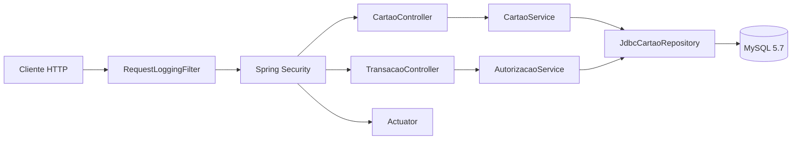

# Mini autorizador

[](https://github.com/AdrielDev/mini-autorizador/actions/workflows/ci.yml)

API REST para cadastrar cartões, consultar saldo e autorizar compras.
Cada cartão começa com R$ 500,00. Uma compra aprovada debita o saldo;
uma recusa não o altera.

Implementado com Java 17, Spring Boot, Spring JDBC, Flyway e MySQL 5.7.
O enunciado original está em [DESAFIO-VR.md](DESAFIO-VR.md).

[Execução](#como-executar) · [API](#api) · [Testes](#testes) ·
[Arquitetura](#arquitetura) · [Decisões](#decisões-de-implementação) ·
[Observabilidade](#observabilidade) · [Evolução](#evolução) ·
[Limites](#suposições-e-limites)

## Como executar

### Pré-requisitos

- JDK 17.
- Docker com suporte a containers Linux e Docker Compose.
- Porta 8080 disponível para a aplicação.
- Porta 3306 disponível para o MySQL fornecido no desafio.

O projeto inclui o Maven Wrapper; não é necessário instalar o Maven.
Execute os comandos na raiz do repositório.

<details open>
<summary><strong>Windows — PowerShell</strong></summary>

Inicie o banco:

```powershell
docker compose -f docker\docker-compose.yml up -d mysql
```

Acompanhe a inicialização:

```powershell
docker compose -f docker\docker-compose.yml logs mysql
```

Aguarde a mensagem `ready for connections` do servidor na porta 3306.
Depois, inicie a aplicação:

```powershell
.\mvnw.cmd spring-boot:run
```

</details>

<details>
<summary><strong>Linux</strong></summary>

Inicie o banco e acompanhe os logs:

```bash
docker compose -f docker/docker-compose.yml up -d mysql
docker compose -f docker/docker-compose.yml logs mysql
```

Após o MySQL ficar pronto:

```bash
./mvnw spring-boot:run
```

</details>

A API fica disponível em `http://localhost:8080`.
O Flyway cria o schema automaticamente na inicialização.

A conexão local utiliza o banco `miniautorizador` em `localhost:3306`,
com usuário `root` e senha vazia, conforme o Compose do desafio.
Essa configuração é destinada ao ambiente local.

### Autenticação

As operações de negócio e os endpoints do Actuator exigem HTTP Basic:

| Credencial | Valor |
|---|---|
| Usuário | `username` |
| Senha | `password` |

Essas credenciais autenticam o acesso à API. A senha do cartão é definida
no cadastro e verificada separadamente na autorização da compra.

## API

URL base: `http://localhost:8080`.

Os POSTs recebem `Content-Type: application/json`.

| Método | Rota | Sucesso | Recusa ou ausência |
|---|---|---|---|
| `POST` | `/cartoes` | `201`, JSON com número e senha recebidos | `422`, JSON com os dados desta tentativa |
| `GET` | `/cartoes/{numeroCartao}` | `200`, saldo numérico | `404`, sem corpo |
| `POST` | `/transacoes` | `201`, texto `OK` | `422`, motivo em texto puro |

### Cadastrar cartão

```json
{
  "numeroCartao": "6549873025634501",
  "senha": "1234"
}
```

As respostas `201` e `422` contêm `numeroCartao` e `senha` da requisição.
O cadastro duplicado não altera os dados existentes.

O retorno da senha segue o contrato do desafio. Não representa
recuperação da senha armazenada, que é persistida somente como hash.

### Consultar saldo

```http
GET /cartoes/6549873025634501
```

Exemplo do corpo da resposta para um cartão recém-criado:

```json
500.00
```

O saldo é um número JSON, sem objeto ou aspas.

### Autorizar compra

```json
{
  "numeroCartao": "6549873025634501",
  "senhaCartao": "1234",
  "valor": 10.00
}
```

Com entrada válida, a prioridade das verificações é:

1. Cartão existente.
2. Senha correta.
3. Saldo disponível.

As respostas de negócio utilizam `text/plain`:

| Status | Corpo |
|---|---|
| `201` | `OK` |
| `422` | `CARTAO_INEXISTENTE` |
| `422` | `SENHA_INVALIDA` |
| `422` | `SALDO_INSUFICIENTE` |

### Autenticação e erros adicionais

Credenciais ausentes ou incorretas resultam em `401`.

Entradas inválidas e falhas tratadas de persistência retornam JSON
com os campos `codigo` e `mensagem`:

| Status | Código | Mensagem |
|---|---|---|
| `400` | `REQUISICAO_INVALIDA` | `Verifique os campos enviados.` |
| `503` | `ERRO_PERSISTENCIA` | `Não foi possível concluir a operação.` |

Falhas técnicas não são convertidas em saldo insuficiente ou aprovação.
Uma resposta inconclusiva não deve ser repetida automaticamente:
a API não possui chave de idempotência.

### Roteiro manual

O arquivo [requests.http](requests.http) contém as chamadas na ordem.

Use um número de cartão ainda não cadastrado. O cadastro inicial precisa
retornar `201`; caso retorne `422`, escolha outro número.

O roteiro verifica a sequência de saldo `500.00 → 495.15 → 0.00`,
as recusas, a autenticação e os endpoints operacionais.

## Testes

| Escopo | Windows — PowerShell | Linux | Docker |
|---|---|---|---|
| Unitários e controllers | `.\mvnw.cmd test` | `./mvnw test` | Não |
| Suíte completa e cobertura | `.\mvnw.cmd clean verify` | `./mvnw clean verify` | Sim |

Por padrão, a integração inicia um MySQL 5.7.44 descartável com
Testcontainers. Não depende do Compose e não altera o banco usado
na execução manual.

A suíte verifica:

- Contratos HTTP, autenticação e validação.
- Migração, cadastro, consulta, duplicidade e hash com salt.
- Precisão monetária e preservação do saldo nas recusas.
- Rollback após uma falha provocada depois do UPDATE real.
- Compras e cadastros concorrentes.
- Disputa pelo mesmo saldo entre dois processos Java.
- Persistência após reiniciar uma instância.
- Identificação das requisições, proteção dos logs e Actuator.

A suíte é sequencial. Os cenários concorrentes coordenam explicitamente
suas próprias tarefas e verificam seus resultados.

### Relatórios e CI

Após `clean verify`:

| Caminho | Conteúdo |
|---|---|
| `target\surefire-reports` | Testes unitários e de controller |
| `target\failsafe-reports` | Testes de integração |
| `target\site\jacoco\index.html` | Cobertura consolidada |
| `target\instance-*.log` | Logs dos processos do teste com duas instâncias |

O [workflow de CI](.github/workflows/ci.yml) executa `clean verify`
em pushes e pull requests, com Java 17 e Docker. Relatórios e logs
ficam no artefato `relatorios-de-testes` por sete dias.

Os ensaios concorrentes comprovam os cenários exercitados.
Não substituem testes de carga nem estabelecem capacidade de produção.

## Arquitetura

A estrutura é em camadas, organizada por funcionalidade. Controllers
tratam HTTP, serviços coordenam regras e o repositório concentra SQL.
As dependências são recebidas por construtor.



Os serviços dependem de `CartaoRepository`, não diretamente do JDBC.
A separação permite testar as regras isoladamente e verificar a
implementação SQL com o banco real.

| Pacote | Responsabilidade |
|---|---|
| `config` | Segurança e configuração do encoder |
| `cartao` | Cadastro, consulta e persistência dos cartões |
| `transacao` | Validação e autorização das compras |
| `shared` | Identificação de requisições, logs HTTP e tratamento de erros |

### Persistência

O Flyway cria a tabela `cartoes`, utilizando InnoDB:

| Coluna | Tipo | Restrições |
|---|---|---|
| `numero_cartao` | `VARCHAR(16)` | Chave primária, não nulo |
| `senha_hash` | `VARCHAR(255)` | Não nulo |
| `saldo` | `DECIMAL(19, 2)` | Não nulo, sem DEFAULT |

Não há tabela de compras: o enunciado exige persistir o cartão e
atualizar seu saldo, mas dispensa o registro das transações.

## Decisões de implementação

<details>
<summary><strong>Concorrência — débito atômico no banco</strong></summary>

A condição de saldo suficiente e o débito fazem parte do mesmo comando:

```sql
UPDATE cartoes
SET saldo = saldo - :valor
WHERE numero_cartao = :numero
  AND saldo >= :valor;
```

Após validar existência e senha, uma linha alterada significa aprovação;
nenhuma significa saldo insuficiente. Contagem inesperada é falha técnica.

| Alternativa | Avaliação |
|---|---|
| UPDATE condicional, adotado | Expressa a regra diretamente no banco, sem calcular um novo saldo em Java |
| Bloqueio pessimista explícito | `SELECT ... FOR UPDATE` anteciparia o bloqueio; seria avaliado se a decisão exigisse leituras e alterações coordenadas |
| Controle otimista por versão | Exigiria versionamento e tratamento de conflitos, que não significam necessariamente saldo insuficiente |

O UPDATE utiliza locks de linha do InnoDB. Não é uma operação sem
bloqueios, mas dispensa adquiri-los explicitamente antes do débito.

A autorização é delimitada por `@Transactional`. Falhas antes do commit
podem provocar rollback, como demonstrado pelo teste com UPDATE real.

A garantia vale entre instâncias que compartilham o banco.
Ela protege o saldo, mas não impede o reenvio da mesma compra.

</details>

<details>
<summary><strong>Persistência e valores — SQL explícito e precisão monetária</strong></summary>

JDBC mantém visíveis os três comandos necessários ao modelo atual,
sem exigir o gerenciamento de entidades de um ORM.

Se o domínio evoluísse para mais agregados, relacionamentos e operações
de persistência, avaliaria Spring Data JDBC ou JPA pelo ganho de
produtividade e custo do mapeamento. Mesmo com ORM, o débito continuaria
exigindo uma operação concorrente segura. Atualizações em lote também
exigiriam cuidado com o contexto de persistência.

A chave primária garante unicidade nos cadastros concorrentes.
Somente `DuplicateKeyException` é traduzida como duplicidade;
outras falhas continuam sendo erros técnicos.

`BigDecimal` e `DECIMAL(19, 2)` evitam cálculos com ponto flutuante.
Valores com fração de centavo são rejeitados, não arredondados.

O saldo inicial é uma regra de cadastro definida no código, sem DEFAULT
no banco. Alterá-la afetaria novos cartões; modificar saldos existentes
seria outra operação de negócio, não um efeito colateral da mudança.

</details>

<details>
<summary><strong>Segurança — contrato do exercício e limites de produção</strong></summary>

HTTP Basic foi mantido por exigência do desafio. Cada chamada apresenta
credenciais; a aplicação não cria uma sessão de login.

A senha do cartão utiliza PBKDF2 com salt gerenciado pelo Spring Security,
sem implementação própria de criptografia. A escolha aproveita a
biblioteca existente e atende ao limite de senha adotado no contrato.

Uma implantação real exigiria HTTPS, gestão e rotação de credenciais,
limitação de tentativas e segregação do acesso operacional.

Também revisaria algoritmo e custo de verificação conforme as
[recomendações da OWASP](https://cheatsheetseries.owasp.org/cheatsheets/Password_Storage_Cheat_Sheet.html),
medindo o impacto sob carga e planejando a migração dos hashes.
Argon2id seria uma opção a avaliar para um novo serviço.

Entre sistemas, OAuth2 Client Credentials poderia permitir tokens
de curta duração e escopos de acesso. Token ou JWT, isoladamente,
não torna uma API segura: HTTPS e validação adequada continuam necessários.

Essas medidas são evoluções possíveis, não recursos desta entrega.

</details>

<details>
<summary><strong>Opcional — fontes Java sem if</strong></summary>

A restrição foi aplicada aos fontes Java de produção e testes,
sem instruções `if`, `break` ou `continue`. Dependências, código gerado
e Maven Wrapper ficam fora desse escopo.

Foram usados `Optional` para presença e ausência, `switch` para resultados
finitos e polimorfismo na finalização dos logs. Nos testes, Awaitility
trata a espera de inicialização e `AutoCloseable` organiza os processos.

Essa escolha atende ao exercício; não é uma recomendação de eliminar
todo `if` de aplicações Java.

</details>

## Observabilidade

Requisições processadas pelo filtro recebem um UUID no header
`X-Request-ID`. O ID fica disponível no MDC durante o processamento
síncrono e o contexto anterior é restaurado ao terminar.

Os logs adicionados pela aplicação registram método, rota parametrizada,
status, duração e resultado da autorização, sem corpos, credenciais,
hashes ou números de cartão. Falhas não tratadas geram um evento sem
inferir um status que ainda será definido pelo container.

Identificadores enviados pelo cliente não são reutilizados.
Essa correlação é local; não representa tracing distribuído.

| Endpoint | Finalidade |
|---|---|
| `/actuator/health` | Saúde da aplicação e do banco, sem detalhes dos componentes |
| `/actuator/metrics/jvm.memory.used` | Uso de memória da JVM |
| `/actuator/metrics/http.server.requests` | Métricas HTTP, sem identificadores de requisição ou cartão como tags |

Todos exigem o mesmo HTTP Basic da API. Em produção, o acesso operacional
seria segregado por perfil ou rede.

<details>
<summary><strong>Diagnóstico inicial</strong></summary>

| Sintoma | Primeira investigação |
|---|---|
| `401` | Credenciais da API, não a senha do cartão |
| `422` | Motivo da recusa e `X-Request-ID`; recusa de negócio não é indisponibilidade |
| `503` | ID nos logs, tipo da falha de persistência, saúde do banco e conexões |
| Latência elevada | Métricas HTTP, CPU, custo das senhas, pool e espera por locks |

Sem idempotência, não é seguro repetir automaticamente uma compra
após timeout ou resposta inconclusiva.

</details>

## Evolução

Os itens abaixo são critérios de evolução, não funcionalidades implementadas.

| Gatilho | Decisão a avaliar |
|---|---|
| Mais tráfego | Medir latência, CPU, pool e locks antes de aumentar instâncias; escalar a API não elimina contenção sobre o mesmo cartão |
| Novas regras de bloqueio, reserva ou limites | Revisar predicados e fronteiras transacionais; considerar versão ou bloqueio explícito quando forem necessárias leituras coordenadas |
| Retentativas da mesma compra | Chave de idempotência, com requisição, resultado e débito coordenados transacionalmente; definir validade e rejeitar reuso com dados diferentes |
| Auditoria e reconciliação | Histórico financeiro e regras de acesso e retenção; logs operacionais não substituem esse registro |
| Integrações assíncronas | Avaliar outbox transacional, broker e consumidores idempotentes, evitando separar a mudança de saldo da garantia de publicação |
| Mais serviços em operação | Propagar contexto de rastreamento, centralizar métricas e criar alertas orientados por SLOs |
| Mais consumidores do contrato | Avaliar OpenAPI, compatibilidade e versionamento; para as três operações atuais, README e roteiro HTTP atendem à reprodução |

Microserviços só seriam considerados diante de fronteiras de domínio
e necessidades reais de implantação ou escala independente.

Para operar em cloud, também seriam necessários testes de capacidade,
timeouts, encerramento gracioso, backup e recuperação. Readiness deveria
considerar dependências críticas; liveness não deveria provocar reinícios
por uma indisponibilidade externa.

MySQL 5.7 foi mantido conforme o desafio. Uma implantação real exigiria
revisar versões suportadas e requisitos de segurança e conformidade
aplicáveis ao produto.

## Suposições e limites

- O número do cartão é textual e possui exatamente 16 dígitos ASCII.
  `VARCHAR(16)` preserva zeros à esquerda. Não há validação de bandeira ou Luhn.
- A senha não pode estar em branco e tem limite de 128 caracteres.
- A compra deve ter valor positivo, caber em `DECIMAL(19, 2)` e ser
  representável em centavos sem arredondamento: `10.000` é aceito;
  `10.001` é rejeitado.
- Campos JSON desconhecidos são ignorados. O cliente não define o saldo inicial.
- Não há recarga, exclusão, alteração de senha ou histórico de compras.
- Não há idempotência. Duas compras distintas podem ter o mesmo cartão,
  valor e horários próximos; reenviar uma compra também pode gerar novo débito.
- Credenciais fixas e banco sem senha atendem ao ambiente local do exercício.
  A entrega não pretende reproduzir todos os controles de um autorizador real.